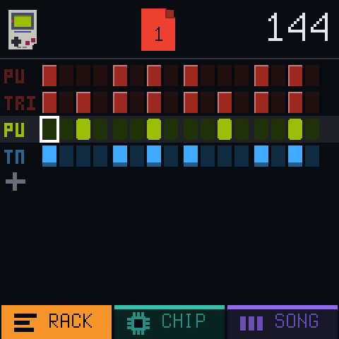
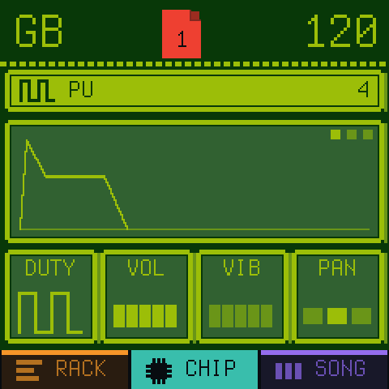
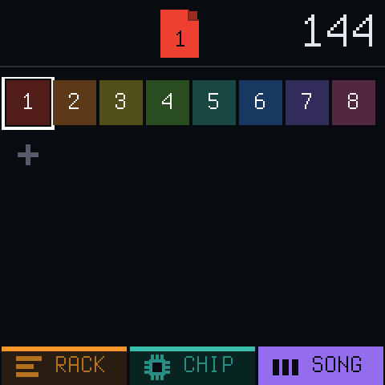

# Chipbox

Chiptune 'grovebox' thing with NES, GB, and SMS stuff

<p>
  
</p>

## What is it

A simple (to me) workflow for making music. Theres 3 main views you'll spend all your time in:

RACK - this is the current page (16 steps). Use this to add channels
CHIPs - this is where you can config each channel. You pick a channel from the hardware first (NES, GB, SMS), and then what channel (like PU1, WAV, etc). If you want appregio, make a channel and change the shape to an appregio shape.
SONG - this is where you stitch together the pages into a song

### Example workflow

- Start on the RACK view. Hit the plus to add a channel.
- Hit HOME to go to the CHIPs, rotate presets knob to get to the channel you added.
- Rotate Algorithm to flip between the configs. Go to the last config page and change the shape.
- Hit HOME, and then add some notes. Use select to go to the exact note, and enter it with the keyboard. Hit play to hear how it sounds as you build it up.
- Hit HOME until SONG is visible. Hit OCT+ to add another page. Select the page, and hit EDIT to open it in the rack, and config it again.

Kind of repeat that a few times until you have something that sounds rad!

wanna make a new song? hold HOME, select an empty project, and hit OCT+. Wanna go back to the other project? hold HOME, and select the previous, then hit OCT+.

want help on any page? hit GLO! stands for 'Get Lots Of help' i guess? i dunno whatever hahaha.

## Play online

No FM-1 handy? The project page has a **Play online** button: the firmware's own code, built for the browser (`web/build.sh`, output in `site/play/`).

## Install

Easiest: the project page's installer (`site/install.html`), in Chrome or Edge with the FM-1 on USB.

## Playing nice with others

- Doesnt read other projects or samples. Sorry, couldnt figure out a good way to do this, or a good reason to.

## Tested?

- Tested on a few real FM-1's!

## Build

Note: I've only ever ran this on a mac. good luck for other platforms

```sh
tools/get_toolchain.sh                      # clang for the chip, to ~/.jieli/toolchain
git clone --depth 1 --branch AC79NN_SDK_V1.2.1_2023-12-13 \
    https://gitee.com/Jieli-Tech/fw-AC79_AIoT_SDK.git ~/fw-AC79_AIoT_SDK
./build.sh                                  # -> build/chipbox.fwsc
./build.sh --release 0.1.0-alpha            # -> build/chipbox-0.1.0-alpha.fwsc
tests/run_host.sh tests/screens.txt         # on Linux: the screens as PNG, no FM-1 needed
```

On a Mac, run the host simulator in Docker (see `docs/RELEASING.md`).

## Licence

GPL-3.0-only, see `LICENSING.md`. Built on [Dinghy](https://github.com/zvenson/dinghy), which is built on
[Felucca](https://github.com/hugelton/Felucca) by Leo Kuroshita (Hügelton Instruments) with the changes of
[SLOOP](https://github.com/isod89/sloop-fm1) (isod89). `docs/API.md` and `docs/RULES.md` describe the platform and
come from Dinghy.
