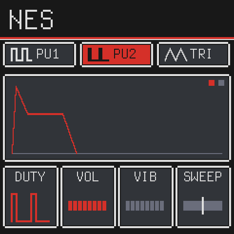
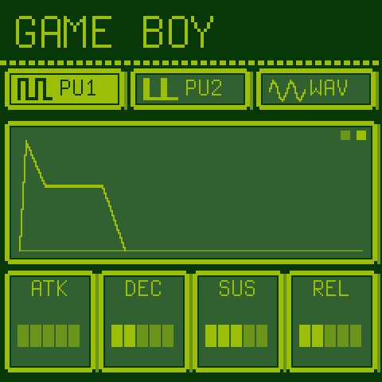
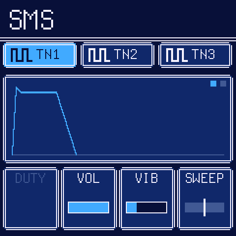
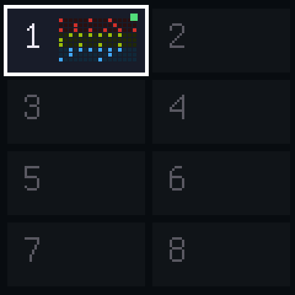
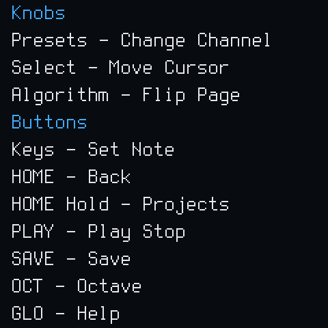

# Chipbox

Chiptune 'grovebox' thing with NES, GB, and SMS stuff **Alpha.**

<p>
  
<br>
  
</p>

## What works

- Kind of a proof of concept right now. Sounds cool. Not really worth installing yet lmao

Not yet: everything

## Install

Download `chipbox-*.fwsc` from the Releases page and, with Python 3:

```sh
pip install mido python-rtmidi
python3 tools/fm1_install.py chipbox-0.1.0-alpha.fwsc
```

## Build

Note: Only ever ran this on a mac. good luck for other platforms

```sh
tools/get_toolchain.sh                      # clang for the chip, to ~/.jieli/toolchain
git clone --depth 1 --branch AC79NN_SDK_V1.2.1_2023-12-13 \
    https://gitee.com/Jieli-Tech/fw-AC79_AIoT_SDK.git ~/fw-AC79_AIoT_SDK
./build.sh                                  # -> build/chipbox.fwsc
./build.sh --release 0.1.0-alpha            # -> build/chipbox-0.1.0-alpha.fwsc
tests/run_host.sh tests/screens.txt         # on Linux: the screens as PNG, no FM-1 needed
```

On a Mac, run the host simulator in Docker (see `docs/RELEASING.md`).

## Versions

`v0.MINOR.PATCH-alpha`: a new minor for new things you can do, a patch for fixes. See `CHANGELOG.md` and
`docs/RELEASING.md`.

## Licence

GPL-3.0-only, see `LICENSING.md`. Built on [Dinghy](https://github.com/zvenson/dinghy), which is built on
[Felucca](https://github.com/hugelton/Felucca) by Leo Kuroshita (Hügelton Instruments) with the changes of
[SLOOP](https://github.com/isod89/sloop-fm1) (isod89). `docs/API.md` and `docs/RULES.md` describe the platform and
come from Dinghy.
