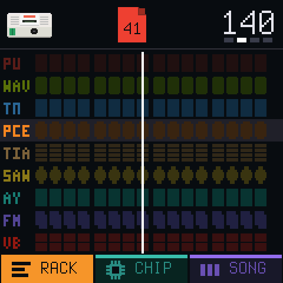
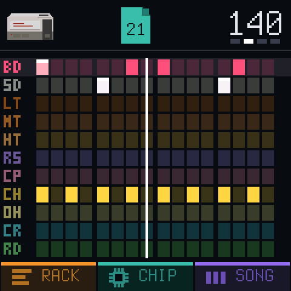
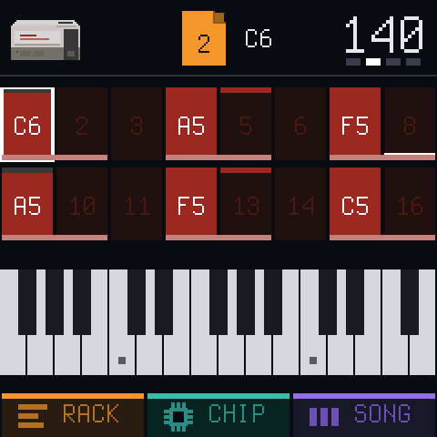
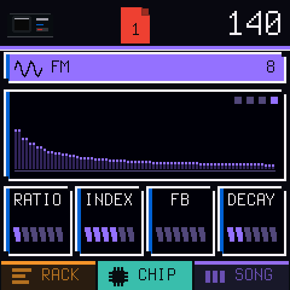
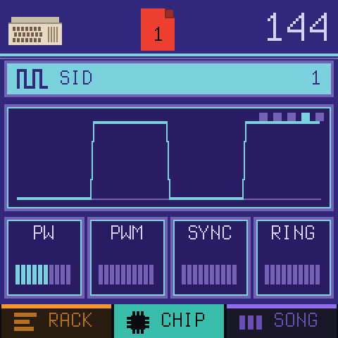
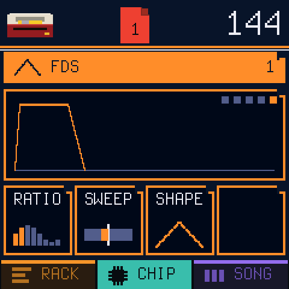

# Chipbox

Chiptune 'grovebox' thing for the FM-1, with more that 35 sound chips!

  
  
  

## What is it

A simple (to me) workflow for making music.

## Links

- [Play online](https://ihavenocluewhatimdoing.com/chipbox/play/)
- [Install](https://ihavenocluewhatimdoing.com/chipbox/install.html)
- [Manual](https://ihavenocluewhatimdoing.com/chipbox/guide/)
- [Tutorials](https://ihavenocluewhatimdoing.com/chipbox/manual/)
- [Cheat sheet](https://ihavenocluewhatimdoing.com/chipbox/cheatsheet/)
- [Projects](https://ihavenocluewhatimdoing.com/chipbox/projects/)

## Chips

| Console        | Channels               | Documentation                                                                                                                                                          |
| -------------- | ---------------------- | ---------------------------------------------------------------------------------------------------------------------------------------------------------------------- |
| NES            | Pulse, Triangle, Drums | [APU](https://www.nesdev.org/wiki/APU), [APU mixer](https://www.nesdev.org/wiki/APU_Mixer) (NESdev wiki)                                                               |
| Game Boy       | Pulse, Wave, Drums     | [Audio](https://gbdev.io/pandocs/Audio.html) (Pan Docs)                                                                                                                |
| Master System  | Tone, Drums            | [SN76489](https://www.smspower.org/Development/SN76489) (SMS Power!)                                                                                                   |
| PC Engine      | Wave, Drums            | [PC Engine](https://tildearrow.org/furnace/doc/latest/7-systems/pce.html) (Furnace manual)                                                                             |
| Atari 2600     | Sound, Drums           | [TIA hardware notes](https://www.atarihq.com/danb/files/TIA_HW_Notes.txt) (Andrew Towers)                                                                              |
| Konami VRC6    | Pulse, Saw, Drums      | [VRC6 audio](https://www.nesdev.org/wiki/VRC6_audio) (NESdev wiki)                                                                                                     |
| AY-3-8910      | Tone, Drums            | [AY-3-8910](https://en.wikipedia.org/wiki/General_Instrument_AY-3-8910) (Wikipedia)                                                                                    |
| Mega Drive     | FM, Drums              | [Mega Drive audio](https://info.sonicretro.org/SCHG:Mega_Drive_Audio) (Sonic Retro), [YM2612](https://en.wikipedia.org/wiki/Yamaha_YM2612) (Wikipedia)                 |
| Virtual Boy    | Wave, Drums            | [Virtual Boy](https://tildearrow.org/furnace/doc/latest/7-systems/virtual-boy.html) (Furnace manual)                                                                   |
| Atari 8-bit    | Sound, Drums           | [POKEY](https://tildearrow.org/furnace/doc/latest/7-systems/pokey.html) (Furnace manual), [POKEY](https://en.wikipedia.org/wiki/POKEY) (Wikipedia)                     |
| PC Speaker     | Beeper, Drums          | [PC speaker](https://tildearrow.org/furnace/doc/latest/7-systems/pcspkr.html) (Furnace manual), [PC speaker](https://en.wikipedia.org/wiki/PC_speaker) (Wikipedia)     |
| AdLib          | FM, Drums              | [OPL](https://tildearrow.org/furnace/doc/latest/7-systems/opl.html) (Furnace manual)                                                                                   |
| Namco WSG      | Wave, Drums            | [Namco WSG](https://tildearrow.org/furnace/doc/latest/7-systems/namco.html) (Furnace manual)                                                                           |
| Namco 163      | Wave, Drums            | [Namco 163 audio](https://www.nesdev.org/wiki/Namco_163_audio) (NESdev wiki)                                                                                           |
| Sunsoft 5B     | Tone, Drums            | [Sunsoft 5B audio](https://www.nesdev.org/wiki/Sunsoft_5B_audio) (NESdev wiki)                                                                                         |
| NES MMC5       | Pulse, Drums           | [MMC5 audio](https://www.nesdev.org/wiki/MMC5_audio) (NESdev wiki)                                                                                                     |
| Famicom Disk   | Wave, Drums            | [FDS audio](https://www.nesdev.org/wiki/FDS_audio) (NESdev wiki)                                                                                                       |
| Konami SCC     | Wave, Drums            | [SCC](https://tildearrow.org/furnace/doc/latest/7-systems/scc.html) (Furnace manual)                                                                                   |
| MSX Music      | FM, Drums              | [OPLL](https://tildearrow.org/furnace/doc/latest/7-systems/opll.html) (Furnace manual)                                                                                 |
| Konami VRC7    | FM, Drums              | [VRC7 audio](https://www.nesdev.org/wiki/VRC7_audio) (NESdev wiki)                                                                                                     |
| Arcade FM      | FM, Drums              | [YM2151](https://tildearrow.org/furnace/doc/latest/7-systems/ym2151.html) (Furnace manual)                                                                             |
| Sound Blaster  | FM, Drums              | [OPL](https://tildearrow.org/furnace/doc/latest/7-systems/opl.html) (Furnace manual)                                                                                   |
| WonderSwan     | Wave, Drums            | [WonderSwan](https://tildearrow.org/furnace/doc/latest/7-systems/wonderswan.html) (Furnace manual)                                                                     |
| Sam Coupe      | Tone, Drums            | [SAA1099](https://tildearrow.org/furnace/doc/latest/7-systems/saa1099.html) (Furnace manual)                                                                           |
| VIC-20         | Tone, Drums            | [VIC-20](https://tildearrow.org/furnace/doc/latest/7-systems/vic20.html) (Furnace manual)                                                                              |
| Plus/4         | Tone, Drums            | [TED](https://tildearrow.org/furnace/doc/latest/7-systems/ted.html) (Furnace manual)                                                                                   |
| Atari Lynx     | Sound, Drums           | [Lynx](https://tildearrow.org/furnace/doc/latest/7-systems/lynx.html) (Furnace manual)                                                                                 |
| PC-98          | FM, SSG, Drums         | [YM2608](https://tildearrow.org/furnace/doc/latest/7-systems/ym2608.html) (Furnace manual)                                                                             |
| Neo Geo        | FM, SSG, Drums         | [YM2610](https://tildearrow.org/furnace/doc/latest/7-systems/ym2610.html) (Furnace manual)                                                                             |
| Neo Geo Pocket | Tone, Drums            | [T6W28](https://tildearrow.org/furnace/doc/latest/7-systems/t6w28.html) (Furnace manual)                                                                               |
| MSX-Audio      | FM, Drums              | [Y8950](https://en.wikipedia.org/wiki/Yamaha_Y8950) (Wikipedia), [OPL](https://tildearrow.org/furnace/doc/latest/7-systems/opl.html) (Furnace manual)                  |
| Yamaha TX81Z   | FM, Drums              | [OPZ](https://tildearrow.org/furnace/doc/latest/7-systems/opz.html) (Furnace manual)                                                                                   |
| SN76477        | Sound, Drums           | [SN76477](https://en.wikipedia.org/wiki/SN76477) (Wikipedia)                                                                                                           |
| Namco System 1 | Wave, Drums            | [Namco](https://tildearrow.org/furnace/doc/latest/7-systems/namco.html) (Furnace manual)                                                                               |
| Korg Poly-800  | Organ, Drums           | [MSM5232](https://tildearrow.org/furnace/doc/latest/7-systems/msm5232.html) (Furnace manual), [Korg Poly-800](https://en.wikipedia.org/wiki/Korg_Poly-800) (Wikipedia) |
| ZX Spectrum    | Beeper, Drums          | [ZX Spectrum](https://en.wikipedia.org/wiki/ZX_Spectrum) (Wikipedia)                                                                                                   |
| NEC PC-88      | FM, SSG, Drums         | [YM2203](https://tildearrow.org/furnace/doc/latest/7-systems/opn.html) (Furnace manual)                                                                                |
| Commodore 64   | Voice, Drums           | [SID](https://www.c64-wiki.com/wiki/SID) (C64-Wiki), [reSID](https://github.com/daglem/reSID) (Dag Lem)                                                                |

## Tested?

- You bet!

## Licence

GPL-3.0-only, see `LICENSING.md`. Built on [Dinghy](https://github.com/zvenson/dinghy), which is built on
[Felucca](https://github.com/hugelton/Felucca) by Leo Kuroshita (Hügelton Instruments) with the changes of
[SLOOP](https://github.com/isod89/sloop-fm1) (isod89). `docs/API.md` and `docs/RULES.md` describe the platform and
come from Dinghy.
